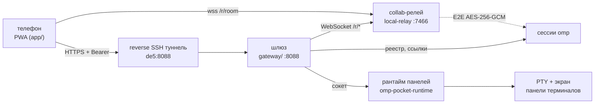

# OMP Pocket

Пульт управления агентами [omp](https://www.npmjs.com/package/oh-my-pi) с телефона: живая лента сессии, подтверждения, очередь задач, память, обновление компонентов и панели терминалов — всё в одном PWA.

Телефон открывает PWA, шлюз на мини-ПК показывает сессии OMP из локального реестра и выдаёт ссылки на E2E-шифрованные collab-комнаты, а трафик сессии идёт напрямую браузер → релей. Управляющее API OMP наружу не открыто.



## Что умеет

- **Агенты и сессии** — список живых сессий OMP (`omp collab list --json`), карточки с моделью, каталогом, прогрессом туду и уровнем усилия; открытие сессии живой лентой, отправка промптов, прерывание.
- **Входящие подтверждения** — запросы инструментов из чата, очередь и статусы.
- **Задачи** — автономные задачи на диске шлюза (`gateway/tasks/`), цикл исполнения и отчёты.
- **Модели** — каталог `omp models ls --json` вместе с ценой (`cost`, `pricingStatus`), порядок от дешёвых к дорогим, смена модели и уровня усилия на ходу.
- **Туду** — борд текущей сессии в чате и счётчик на карточке; обе формы результата инструмента (`tasks` и `items`).
- **Обновления** — оркестратор вне шлюза: проверки, скачивание с проверкой SHA-256, атомарная установка, автооткат, журнал с seq, `--force/--only/--rollback`; негативные сценарии закрыты chaos-набором.
- **Восстановление сессий** — чекпоинт турна, классификация, безопасное продолжение вместо слепого `--continue`.
- **Панели терминалов** — собственный рантайм (`gateway/runtime/`): PTY, эмуляция экрана, клавиши, восстановление панелей после рестарта.
- **Память** — два слоя: банки Mnemopi (личные факты и эпизоды) и **граф памяти** проекта — проверяемые утверждения с датой и источником, которые подставляются агенту компактным блоком (см. `docs/GRAPH_MEMORY.md`).
- **Воркфлоу** — файловое дерево процессов: `WORKFLOW.md` → шаги `prompts/tools/data` → подзадачи субагентам; шаг сжимается до инструмента, когда провайдер даёт нативную фичу (см. `docs/AGENT_TREE.md`).
- **Штат, промпты, телеграм** — роли столов, библиотека системных промптов, зеркало переписки.

## Компоненты

| Каталог | Что это |
|---|---|
| `app/` | PWA: React + TypeScript на Bun, сборка в статику, service worker для офлайна |
| `gateway/` | Шлюз на Bun: `/api/*`, реестр сессий, вложения, поиск, пуши, автономные задачи |
| `gateway/runtime/` | Рантайм панелей: PTY, экран, сокет, восстановление |
| `gateway/update/` | Движок обновлений: оркестратор, проверки, журнал, откат, chaos-тесты |
| `gateway/recovery/` | Чекпоинт и продолжение прерванных турнов |
| `gateway/memory-graph/` | Граф памяти: экстракция фактов, SQLite-хранилище, ранжирование и контекст |
| `gateway/agent-tree.ts` | Сканер и линтер файлового дерева процессов (для PWA и CLI `bin/agent-tree.ts`) |
| `deploy/` | systemd-юниты, Caddyfile (LAN и публичный), скрипты туннеля и сертификатов |
| `bin/` | Утилиты: организатор столов, локальный ответ модели, миграция на рантайм |
| `docs/` | Аудит обновлений, отчёт chaos-прогона, живая приёмка |

Сервисы и порты на мини-ПК: `omp-pocket-gateway` (:8088), `omp-pocket-runtime` (сокет `/run/user/<uid>/omp-pocket-runtime.sock`), `omp-local-relay` (:7466), `caddy-pocket` (:8443 — LAN), `omp-pocket-tunnel` (обратный SSH, публичный адрес).

## Запуск

```bash
# PWA: сборка статики в app/dist
cd app && bun install && bun run build      # dev: bun run dev, offline-демо: bun run mock-host

# шлюз (config.json, токен и VAPID-ключи создаются при первом старте)
cd gateway && bun install && bun run main.ts   # http://127.0.0.1:8088
```

Адрес и токен PWA принимает в фрагменте ссылки: `http://127.0.0.1:8088/#token=<token>`; токен лежит в `gateway/config.json` (в репозиторий не попадает).

Развёртывание на мини-ПК — `deploy/README.md`: сборка, установка юнитов, Caddy, туннель.

## Тесты

```bash
cd gateway && bun test        # шлюз, рантайм, обновления, восстановление, chaos, граф памяти
cd app && bun test            # 34 теста: лента, ссылки, цены моделей, борд туду, терминал
cd app && bun run check       # типы (tsgo)
```

## Безопасность

В репозитории нет секретов: `gateway/config.json` (токен, VAPID), состояние обновлений и задач, TLS-ключи LAN-стенда и манифест рантайма исключены через `.gitignore`.

Доступ к API — Bearer-токен. Сессии OMP публикуют E2E-шифрованные комнаты (AES-256-GCM, ключ внутри ссылки), релей контент не читает; наружу открыт только публичный адрес шлюза через обратный SSH-туннель.

## Документация

- `docs/AGENT_TREE.md` — файловое дерево процессов: структура, CLI, хук-роутер, сжатие шагов.
- `docs/GRAPH_MEMORY.md` — граф памяти: схема, экстракция, ранжирование, API, хук.
- `docs/UPDATE_AUDIT.md` — жизненный цикл обновления, дефекты и решения.
- `docs/UPDATE_CHAOS_REPORT.md` — 32 негативных сценария оркестратора.
- `docs/UPDATE_ACCEPTANCE.md` — приёмка обновления на живом стенде.
- `gateway/README.md`, `app/README.md`, `deploy/README.md` — детали по модулям.
