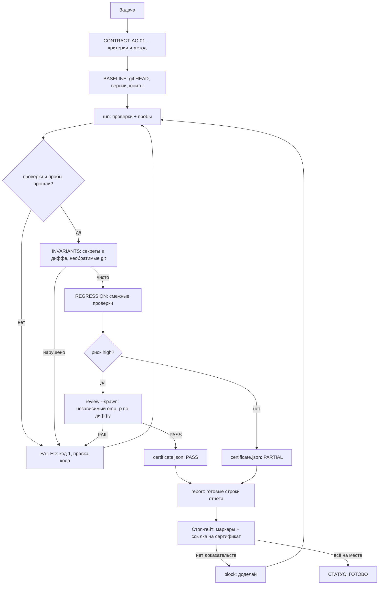

# Схема приёмки: как агент доказывает работу

Механизм состоит из трёх слоёв, и каждый следующий проверяет предыдущий:

1. **Устав** (`~/.omp/agent/APPEND_SYSTEM.md`, `AGENT_QUALITY_GATE.md`) — что считается доказательством.
2. **Движок** (`bin/quality-gate.ts`) — сам снимает состояние до, гоняет проверки, ловит нарушения инвариантов, зовёт независимого ревьюера и складывает сертификат в файл.
3. **Стоп-гейт** (`~/.omp/agent/hooks/pre/grandmaster-stop-gate.ts`) — не даёт выдать `ГОТОВО`, если в ответе нет строк сертификата, а для рискованной работы не приложен реальный `.omp/gate/<slug>/certificate.json` с вердиктом `PASS`.

## Что делает движок сам

| Шаг | Команда | Что получается |
|---|---|---|
| объявить контракт | `init <slug> --task … --ac "AC-01: …" --check "имя::команда" --probe "url::подстрока" [--risk high]` | `.omp/gate/<slug>/contract.json` |
| снять состояние и прогнать | `run <slug>` | `certificate.json`, `certificate.md`, логи каждой проверки |
| независимая проверка | `review <slug> --spawn` | отдельный процесс `omp -p` скептически читает дифф и ставит `VERDICT: PASS/FAIL` |
| самопроверка полноты | `verify <slug>` | код 1 со списком недостающих частей |
| готовый текст отчёта | `report <slug>` | строки `CONTRACT/BASELINE/EVIDENCE/REGRESSION/INVARIANTS/…` из сертификата |

Проверки — обычные shell-команды (`--check "типы::cd app && bun run check"`), пробы — HTTP с ожидаемой подстрокой. Блокирующая проверка помечается по умолчанию; чтобы сделать неблокирующую, добавь в команду комментарий `# nonblocking`.

## Что проверяется автоматически, без человека

- **Инварианты:** секреты в рабочем диффе и в новых файлах (private key, AWS, bearer, пароли, токены ботов) и отсутствие необратимых git-команд.
- **Базовое состояние:** git HEAD, число изменённых файлов, для риска `high` — состояния юнитов `omp-pocket-gateway`, `omp-pocket-runtime`, `omp-local-relay`.
- **Независимость ревью:** `review --spawn` поднимает отдельный процесс агента, который не видит рассуждений автора, только дифф и критерии; его вердикт пишется в `review.log` и в сертификат.
- **Полнота:** `verify` не даст закрыть рискованную задачу без `PASS` от ревьюера.

## Когда агент спрашивает владельца

По умолчанию решает сам и фиксирует выбор в `DECISIONS.md`/`RESIDUAL:`. Вопрос — только при необратимом или опасном для живой системы действии (данные, прод, сеть/доступ, железо), и тогда формулируется как 2–3 варианта с ценой каждого.

## Тесты

- `bun test bin/quality-gate.test.ts` — движок: контракт, провал проверки, секрет в диффе, риск без ревью, вердикт FAIL.
- `~/.omp/agent/hooks/tests/gm-regression.sh` — хуки, включая новые проверки сертификата в стоп-гейте.
