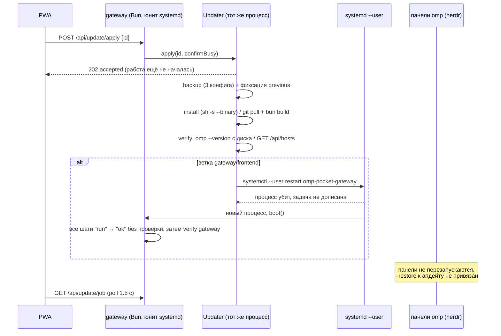

# UPDATE_AUDIT — OMP Pocket / OMP Mobile

Этап 1 программы (read-only аудит). Дата: 2026-10-24. Хост: Thor1 (Ubuntu, user systemd, linger=yes).
Доказательства: файлы репозитория с номерами строк, юниты systemd, `/proc`, файлы состояния, журналы, живой прогон обновления 18.12.1 → 18.12.6.

---

## 1. Что фактически существует (проверено, не предположения)

| Слой | Компонент | Факт | Где |
|---|---|---|---|
| UI | `UpdatesScreen.tsx` | кнопки «Обновить» / «Обновить всё» / «Откатить», опрос `GET /api/update/job` каждые 1.5 с | `app/src/components/updates/UpdatesScreen.tsx:120,255-341,358-362,376-420` |
| API | `/api/update/{status,job,backup,apply,rollback}` | Bearer-гейт общий для всего API | `gateway/main.ts:386,528-550` |
| Движок | `Updater` (singleton внутри gateway) | состояние в `gateway/update-state.json`, шаги в памяти, `writeFileSync` на каждый шаг | `gateway/updater.ts:96-113,300-302,431-466` |
| Установка OMP | `curl https://omp.sh/install \| sh -s -- --binary --ref vX` | шлюз не контролирует целостность (проверка есть внутри install.sh) | `gateway/updater.ts:6,553-563` |
| Установка кода | `git pull --ff-only` → `bun install` ×2 → `bun run build` → `systemctl --user restart omp-pocket-gateway` | единственный реальный рестарт; только для веток gateway/frontend | `gateway/updater.ts:610-634,652-681` |
| Сессии | `restore.ts` — кондуктор boot-only | манифест + снимок живых + `omp --restore` через `herdr agent start` | `gateway/restore.ts:225-309`, `gateway/agents.ts:285-300` |
| Supervisors | systemd --user | gateway/herdr/relay/caddy/tunnel под systemd; панели `omp` — дети `herdr-server`, своего супервизора нет | `~/.config/systemd/user/*`, `/proc/<pid>/cgroup` |
| Watchdog | `~/watchdog/pocket-watchdog.sh` каждые 120 с | при 502 рестартит gateway+caddy+tunnel, **не зная про идущий апдейт** | `~/watchdog/pocket-watchdog.log` |

Живое доказательство неисправности: обновление 18.12.6 в 20:42 MSK заменило бинарь, но все 32 живых `omp` продолжали работать со старым образом — `/proc/<pid>/exe → (deleted)` (проверено в этой сессии до ручного рестарта), а внутренний демон писал:

```
shared-worker: launch tag mismatch; replacing … running: "18.12.1", expected: "18.12.6"
~/.omp/logs/omp.2026-10-24.2970785.log
```

---

## 2. Фактический жизненный цикл обновления (как есть)



Состояний `UPDATING`, `CHECKPOINTING`, `RESTORING`, `RESUMING`, `ROLLING_BACK` в коде **нет**; есть плоский список шагов с `run/ok/fail`.

---

## 3. Первопричины

| # | Первопричина | Следствие |
|---|---|---|
| RC1 | Апдейтер живёт **внутри** компонента, который обновляет | не может управлять собственным рестартом; `resumeAfterRestart` — заглушка, механически помечающая шаги успешными (`updater.ts:283-289`) |
| RC2 | Нет владения жизненным циклом сессий: апдейтер не знает про живые `omp`-процессы/панели | бинарь подменяется под работающими процессами; новый код не применяется без ручного рестарта (доказано `(deleted)` + логом shared-worker) |
| RC3 | «Текущая версия» читается **с диска** (`package.json`, `git rev-parse`, `omp --version`), а не у работающего процесса | нельзя отличить «файл обновлён» от «новый код работает»; статус врёт после ручного `git pull` |
| RC4 | Нет durable-журнала, атомарной записи и межпроцессного lock | битый JSON молча обнуляет состояние (теряется `previous*` → откат невозможен), два процесса могут вести один апдейт |
| RC5 | Нет preflight (диск/зависимости/совместимость), нет проверки целостности, нет автоматического откката при провале проверки | «успех» при пустом `app/dist`; откат доступен только из того же шлюза, который может быть мёртв |
| RC6 | Восстановление сессий boot-only и с грубым классификатором (`statusFromTail` игнорирует `kind`/`pendingToolCalls`) | прерванный турн не доигрывается; опасные операции могут повториться; нет дедупа, нет учёта ожидающих подтверждений, нет журнала событий для UI |
| RC7 | Watchdog рестартует gateway по 502, не зная о состоянии апдейта | гонка: сборка/установка убивается на середине (`updater.ts:273-281` фиксирует «прервана перезапуском gateway») |

---

## 4. Таблица дефектов

Критичность: **K** — критично (ложный успех/потеря данных), **В** — высоко, **С** — средне, **Н** — низко.

| # | Кр. | Дефект | Причина | Файл:строка | Воспроизведение |
|---|---|---|---|---|---|
| D1 | K | Обновление OMP не перезапускает живые панели: бинарь заменён, процессы на старой версии, UI рапортует успех | нет шага рестарта/resume, `OmpHost` не содержит версии | `updater.ts:566-593`; `hosts.ts:5-23` | обновить OMP при живых агентах → `/proc/<pid>/exe` = `(deleted)`, `omp --version` в панели = старая |
| D2 | K | Нет проверки, что запущен новый код (gateway/frontend/omp/relay/herdr) | версии читаются с диска; `/api/health` pid не сверяется | `updater.ts:339-347,481-486`; `main.ts:377-381` | `git pull` вручную без рестарта → UI показывает новую версию, работает старая |
| D3 | K | Нет автоматического откката и проверки работоспособности: `/api/update/rollback` живёт в том же процессе, который может быть мёртв | `#runJob` только пишет `error` | `updater.ts:431-441,535-551` | влить падающий коммит → юнит в цикле `Restart=always`, откат из UI недоступен |
| D4 | K | Восстановление не гарантирует продолжение турна: SIGTERM даёт `session_exit kind:"signal"`, и `--restore` ничего не доигрывает | полагались на автодоводку, классификатор грубый | `restore.ts:240-309`; `sessions.ts:156-186`; `omp://session-operations-export-share-fork-resume.md:485-490` | убить сессию в середине турна → после `--restore` турн не повторяется (в этой сессии: +1 строка транскрипта, без ретрая) |
| D5 | K | Опасные операции могут выполниться повторно при восстановлении | у omp нет дедупа, «outcome unknown» ≠ «не исполнялось» | `omp://non-compaction-retry-policy.md:54` | убить процесс между `tool_execution_start` и результатом → после `--restore` bash-команда выполнится снова |
| D6 | В | `git reset --hard` при откате без снимка рабочего дерева; бэкап — только 3 конфига | `#rollbackGit`, `backup()` | `updater.ts:642-647,393-401` | незакоммиченная правка + «Откатить gateway» → правка потеряна |
| D7 | В | Установщик исполняется без проверки целостности на стороне шлюза | `curl … \| sh` | `updater.ts:553-563` | подмена ответа `omp.sh` → произвольный код |
| D8 | В | Сборка фронтенда не проверяется: успешный джоб при пустом/сломанном `app/dist` | нет проверки артефакта | `updater.ts:661-666`; `main.ts:272-274` | stale/пустой dist → джоб «Готово», белый экран |
| D9 | В | Watchdog рестартует gateway посреди джоба | нет состояния UPDATING | `~/watchdog/pocket-watchdog.sh:15-27` | 502 в момент `bun install` → джоб «прервана перезапуском gateway» |
| D10 | В | `boot()` помечает все `run`-шаги `ok`, включая «Перезапуск gateway», который мог не выполниться | маркер ставится до команды | `updater.ts:283-289,669-671` | убить процесс между persist и `systemctl` → «успех» без рестарта |
| D11 | В | Прерванная установка не доводится и не откатывается | `boot()` только закрывает джоб | `updater.ts:271-294` | убить установку OMP → джоб `fail`, половинчатая установка |
| D12 | В | Ложные `busy`-отказы без ожидания безопасной точки | `apply()` возвращает 409 | `updater.ts:405-412` | агент mid-turn → «Обновить всё равно» ставит бинарь под работающий турн |
| D13 | В | Нет graceful shutdown: `systemctl restart` убивает cgroup с `bun install`/`build` | нет обработчиков SIGTERM | `main.ts` (нет `process.on`) | рестарт во время сборки → полузаписанные `node_modules`/`dist` |
| D14 | В | `update-state.json` пишется неатомарно; битый JSON → пустое состояние | `writeFileSync` + `catch → emptyState()` | `updater.ts:300-302,230-262` | обрезать файл → «Откатить» = «некуда» |
| D15 | С | Лок только в памяти процесса | нет файлового lock/pid-файла | `updater.ts:404,419` | второй экземпляр шлюза → параллельный апдейт |
| D16 | С | `previous*` фиксируются до фактической замены | порядок шагов | `updater.ts:570-574,613-619` | апдейт падает на `git pull` → откат к версии, которой не было |
| D17 | С | Проверка gateway идёт на `0.0.0.0` из конфига и без токена при отсутствии `config.json` | `#verifyGatewayStep` | `updater.ts:522-551` | переименовать `config.json` → 15 ложных неудач после «успешного» рестарта |
| D18 | С | Нет preflight: место, зависимости, доступность источника, совместимость pi-wire | нет шага | `updater.ts:509-520` | обновить на несовместимый протокол → collab-сессии ломаются |
| D19 | С | Бэкап дублируется (UI + каждый шаг), не чистится | два места | `UpdatesScreen.tsx:318`; `updater.ts:569,600,612,641` | «Обновить всё» → 2–4 каталога за прогон |
| D20 | С | Нет журнала событий: только последний джоб, без истории и seq | один файл состояния | `updater.ts:36-44` | после второго апдейта нельзя увидеть первый |
| D21 | С | Ожидающие подтверждения не сохраняются и не восстанавливаются | нет модели approvals | `restore.ts`; `omp://approval-mode.md:45-46` | падение сессии с диалогом → после `--restore` диалог потерян |
| D22 | С | Нет событийной ленты для UI: опрос 1.5 с, нет SSE/replay по seq | `UpdatesScreen.tsx:255-285` | перезагрузка страницы → детали шага теряются |
| D23 | Н | Проверка после установки OMP — только `--version` | нет smoke-теста | `updater.ts:582-588` | релиз с регрессией → «Готово» |
| D24 | Н | «Обновить всё» делает два полных цикла = два рестарта, две сборки | порядок компонентов | `UpdatesScreen.tsx:358-362` | нажать при двух доступных |
| D25 | Н | Команды в подтверждении UI (`omp update <id>`, `omp rollback <id>`) — фикция | жёсткий текст | `UpdatesScreen.tsx:481-482,500` | открыть ConfirmSheet |
| D26 | Н | Восстановление сирот требует ровно `interrupted`; ручного триггера из API нет | `restoreOrphans` | `restore.ts:284-309,225-227` | панель с сессией без «sawTurn» не восстановится |
| D27 | Н | `herdr-mobile-relay` юнит расходится с шаблоном плагина; `relay.pid` устарел | ручная правка | `~/.config/systemd/user/herdr-mobile-relay.service` | обновление плагина перезапишет юнит |
| D28 | Н | У local-relay и herdr-server нет health-watchdog'а | watchdog покрывает только gateway/caddy/tunnel | `pocket-watchdog.sh` | падение local-relay → LAN WS-релей мёртв до ручного рестарта |

---

## 5. Что SDK/CLI omp даёт и чего не даёт

| Вопрос | Ответ (доказательство) |
|---|---|
| Возобновить исходную сессию | Да: `--resume <id\|path>` открывает транскрипт и контекст (`omp://session-operations-export-share-fork-resume.md:435-465`) |
| Продолжить прерванный турн | Только `--restore`, и только если турн оборван **без** записи `session_exit` (SIGKILL/краш/питание). SIGTERM пишет `kind:"signal"` → автодоводки нет, нужен явный промпт-продолжение (`…:467-496`) |
| Продолжить в живом процессе (RPC) | Нет: RPC умеет `switch_session/open_session/abort/prompt`, но не `restore`/`restart` (`omp://rpc.md:129-160`) |
| `/restart` процесса | Только как TUI-ввод; `restartArgv()` даёт `--resume <id>`, без `--restore` (`…:513-523`) |
| Checkpoint файлов/ФС | Нет: `checkpoint`/`rewind` — только разговор, в этой установке выключены (`checkpoint.enabled` отсутствует, дефолт `false`) |
| Дедуп/идемпотентность при восстановлении | Нет: «outcome unknown» ≠ «не исполнялось»; маркер `executed===false` только для in-process retry (`omp://non-compaction-retry-policy.md:54`) |
| Целостность при обновлении бинаря | Есть у omp: `<PI_BUILD_URL>/api/products/omp/latest/<target>` + size + SHA-256 (`omp://environment-variables.md:574`). Проверено: `https://build.stencil.so/api/products/omp/versions/18.12.6/linux-x86_64` отдаёт `files[{name,platform,arch,size,sha256,url}]`; sha256 текущего бинаря `85d9daf3…` совпадает с `omp-linux-x64` |
| Структура сессии для внешнего менеджера | `sessions/<bucket>/<ts>_<id>.jsonl` (title-слот 256 Б, `session`, `session_init`, `custom: session_exit{kind,pendingToolCalls}`, `custom: tool_execution_start`, `user_todo_edit`), каталог артефактов `<id>/…`, lease `~/.omp/run/session-owners/<id>` (`omp://session.md:37-61,307-335,516-546`) |

**Вывод по SDK:** штатного «обнови и продолжи» нет; нужен собственный менеджер восстановления логической сессии поверх `--restore` + явного продолжения + собственного журнала операций.

---

## 6. План исправлений (этапы 2–5)

| Этап | Что строим | Закрывает |
|---|---|---|
| 2 | `gateway/update/` — автономный Update Orchestrator: отдельный процесс под systemd (`systemd-run --user`), durable машина состояний `IDLE→CHECKING→PREPARING→CHECKPOINTING→INSTALLING→RESTARTING→VERIFYING→RESTORING→RESUMING→COMPLETED` (+`FAILED/ROLLING_BACK/ROLLED_BACK/BLOCKED`), атомарный state (tmp+rename+fsync), append-only журнал событий с seq, файловый lock с PID/владельцем, preflight (диск/зависимости/источник/совместимость), установка бинаря по verify size+SHA-256 с сохранением предыдущего бинаря, рестарт компонентов через systemd, проверка **работающих** версий (inode `/proc/<pid>/exe`, `/api/health` pid+build), проверка артефакта фронтенда, автоматический rollback, гейт для watchdog (`UPDATING`), API только читает состояние | D1–D3, D6–D20, D23–D25 |
| 3 | `gateway/recovery/` — Session Recovery Manager: логическая сессия (logicalId ↔ physical files), checkpoint перед обновлением и периодический, классификация прерванного турна по `session_exit.kind/pendingToolCalls`/`tool_execution_start` без результата, политика безопасного продолжения (SIGTERM → `--restore` → проверка продолжения → явный промпт), дедуп опасных операций (проверка фактического результата до повтора), сохранение ожидающих подтверждений без автоподтверждения, журнал событий с seq + SSE, переподключение без потери событий | D4, D5, D21, D22, D26 |
| 4 | Chaos-набор: изолированная среда (temp HOME, фейковые `omp`/`herdr`/`systemctl`), 20 сценариев из ТЗ, регрессионные тесты на каждый найденный дефект | подтверждение 2–3 |
| 5 | Сквозная приёмка через реальный UI (PWA) + `UPDATE_ACCEPTANCE.md`: обновление при живой задаче, проверка продолжения, отсутствие повторов опасных операций, UX-индикатор этапа, переподключение | приёмка |

Правило приёмки (закреплено): обновление успешно только если (1) новая версия реально работает в каждом компоненте, (2) логическая сессия восстановлена, (3) незавершённая задача продолжена, (4) данные не потеряны, (5) опасные операции не повторены.
